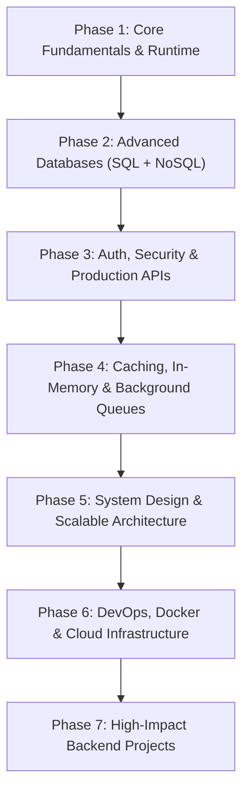
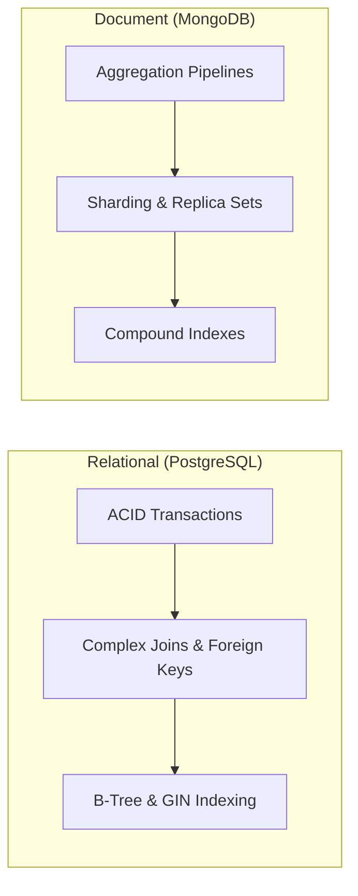
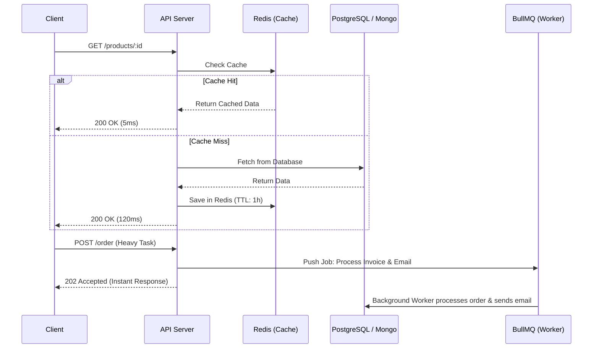
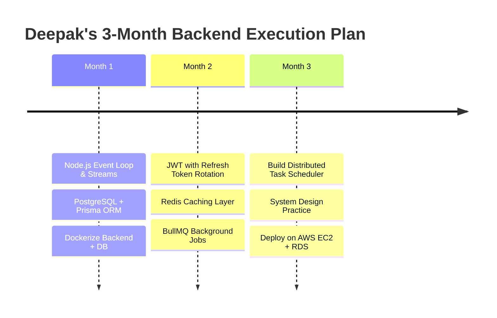

# 🚀 The Ultimate Backend Engineering Roadmap (2026 Edition)
> **Tailored for Deepak Prasad Verma** (B.Tech IT, UCET Hazaribagh)  
> *From MERN CRUD Developer → Scalable Distributed Systems & High-Paying Backend Engineer*

---

## 🗺️ High-Level Backend Architecture Roadmap

---

## Phase 1: Core Fundamentals & Runtime Internals (Weeks 1 – 4)

Aapne **OSHN BLRREALTOR** mein Express aur Node.js use kiya hai. Ab standard CRUD se aage badhkar runtime ke internals samajhna zaroori hai.

### 1. Node.js Internals
- **Event Loop Deep-Dive**: Timers, Pending Callbacks, Poll, Check (setImmediate), Close Callbacks.
- **Microtasks vs Macrotasks**: `process.nextTick()`, `Promise.then()` priority queue.
- **Libuv & Thread Pool**: Kaise Node.js asynchronous I/O handle karta hai aur `UV_THREADPOOL_SIZE` kya hota hai.
- **Streams & Buffers**: 
  - `Readable`, `Writable`, `Transform`, `Duplex` streams.
  - Large file uploads aur streaming audio/video memory leak ke bina process karna (`pipeline`, `pipe`).
- **Cluster Module & Worker Threads**: Multi-core CPU utilization for CPU-intensive tasks.

### 2. Networking & Web Protocols
- **HTTP/1.1 vs HTTP/2 vs HTTP/3**: Multiplexing, Server Push, Header Compression (HPACK).
- **TCP vs UDP**: Handshakes, Packet loss handling, use cases in realtime apps.
- **REST Best Practices**: Idempotency (`GET`, `PUT`, `DELETE`), HATEOAS, standard status codes (201, 204, 400, 401, 403, 409, 422, 429, 502).
- **WebSockets vs SSE (Server-Sent Events)**: Full-duplex vs unidirectional server push.

> [!TIP]
> **Action Item**: Node.js core modules (`fs/promises`, `stream`, `crypto`, `http`, `events`) ko bina kisi npm package ke use karke ek custom HTTP mini-server ya file streaming utility banayein.

---

## Phase 2: Database Mastery — SQL + Advanced NoSQL (Weeks 5 – 9)

Companies mein sirf MongoDB nahi, **PostgreSQL** industry standard hai. Aapko dono ka deep knowledge hona chahiye.

### 1. PostgreSQL (Must Learn)
- **Schema Design & Normalization**: 1NF, 2NF, 3NF, ER Diagrams.
- **ACID Properties**: Atomicity, Consistency, Isolation levels (Read Committed, Repeatable Read, Serializable), Durability.
- **Indexing Strategies**:
  - `B-Tree` (default, range queries).
  - `Hash` (equality lookup).
  - `GIN / GiST` (Full-text search, JSONB indexing).
  - `EXPLAIN ANALYZE`: Slow query profiling aur execution plan optimization.
- **Modern ORM / Query Builders**:
  - **Prisma** (type-safe, clean schema migrations).
  - **Drizzle ORM** (lightweight, high performance).

### 2. Advanced MongoDB (Level-Up from your current skills)
- **Aggregation Pipeline Mastery**: `$match`, `$group`, `$lookup` (Left Outer Join), `$facet`, `$unwind`, `$project`.
- **Indexing in MongoDB**: Single field, Compound index, TTL (Time-To-Live for OTPs/sessions), Text Index.
- **Transactions in MongoDB**: Multi-document ACID transactions with session management.

---

## Phase 3: Auth, Security & Production API Design (Weeks 10 – 13)

### 1. Robust Authentication & Authorization
- **JWT (JSON Web Tokens)**:
  - Short-lived Access Token (15 mins) + Stored Refresh Token (7 days) with **Token Rotation**.
  - Secure storage: `HttpOnly`, `SameSite=Strict`, `Secure` cookies (XSS protection).
- **OAuth 2.0 & OpenID Connect**: Google, GitHub single sign-on (SSO).
- **RBAC (Role-Based Access Control)**: Admin, User, Moderator permissions middleware.

### 2. Backend Security & Defense
- **Input Validation**: Schema validation using **Zod** ya **Joi**.
- **Rate Limiting**: IP-based & User-based limiting using `express-rate-limit` & Redis.
- **Security Headers**: `helmet` (HSTS, CSP, X-Frame-Options).
- **CORS Deep Dive**: Origin, Preflight (`OPTIONS`), Credentials, Allowed Headers.
- **Password Hashing**: `argon2` ya `bcrypt` (work factor tuning).

---

## Phase 4: Caching, In-Memory DB & Asynchronous Queues (Weeks 14 – 17)

### 1. Redis Caching Patterns
- **Cache-Aside Pattern** (Lazy loading).
- **Write-Through & Write-Back** caching.
- **Cache Invalidation**: TTL expiry, stale-while-revalidate, event-driven invalidation.
- **Cache Stampede Prevention**: Mutex lock / Probabilistic early expiration.

### 2. Background Job Queues
- **BullMQ / Celery**: Asynchronous heavy task offloading (Sending emails, generating PDF reports, video transcoding, payment webhooks).
- **Dead Letter Queues (DLQ)**: Failed job retries with exponential backoff.

---

## Phase 5: System Design & Scalable Architecture (Weeks 18 – 22)

### 1. Architectural Patterns
- **Modular Monolith**: Codebase organized by domains before jumping to microservices.
- **Microservices**: Decoupled services communicating over REST, gRPC, ya Event Bus.
- **API Gateway**: Reverse proxy, request routing, rate limiting, authentication offloading.
- **Event-Driven Architecture**:
  - Message Brokers: **RabbitMQ** (flexible routing) ya **Apache Kafka** (high-throughput event streaming).

### 2. System Design Core Concepts
- **Load Balancing**: Round-Robin, Least Connections, IP Hash (Nginx / AWS ALB).
- **Horizontal vs Vertical Scaling**: Stateless servers, sticky sessions elimination.
- **Database Scaling**:
  - Read Replicas (Master-Slave architecture).
  - Sharding (Hash-based / Range-based partitioning).
- **Consistency Models**: CAP Theorem, PACELC, Eventual Consistency.

---

## Phase 6: DevOps, Cloud & Observability (Weeks 23 – 26)

Sirf local machine par code chalana kaafi nahi hai; use production mein maintain karna seekhein:

### 1. Containerization & Orchestration
- **Docker**: Writing production-grade multi-stage `Dockerfile` (Alpine/Debian slim).
- **Docker Compose**: Orchestrating API + PostgreSQL + Redis + Worker containers with 1 command (`docker compose up`).

### 2. CI/CD & Cloud Infrastructure
- **GitHub Actions**: Automated testing, linting, Docker build, and deployment triggers.
- **Cloud Providers (AWS / GCP)**:
  - **AWS EC2 / ECS**: Deploying containerized services.
  - **AWS S3**: Cloud object storage for user uploads (presigned URLs).
  - **AWS RDS**: Managed PostgreSQL/MySQL with automated backups.

### 3. Observability (Logging & Monitoring)
- **Structured Logging**: `winston` ya `pino` with JSON format.
- **Metrics & Tracing**: Prometheus, Grafana, OpenTelemetry.
- **Graceful Shutdown**: Handling `SIGTERM` / `SIGINT` to safely close database connections and finish in-flight requests.

---

## 🏆 4 High-Impact Portfolio Backend Projects (To Get Hired)

| # | Project Name | Tech Stack | Key Engineering Highlight |
|---|---|---|---|
| **1** | **High-Throughput URL Shortener & Analytics** | Node.js, PostgreSQL, Redis, Docker | Base62 encoding, Redis caching, Bloom filters, Click analytics aggregation |
| **2** | **Distributed Task Scheduler & Job Queue** | Express/Fastify, BullMQ, Redis, PostgreSQL | Crontab syntax support, concurrency control, DLQ retries, worker health dashboard |
| **3** | **Real-Time Collaborative Doc / Chat Engine** | Node.js, WebSockets (Socket.io/ws), Redis Pub/Sub | Cross-server message broadcast with Redis Pub/Sub adapter, presence tracking |
| **4** | **Microservices E-Commerce Order & Payment Pipeline** | Express, PostgreSQL, RabbitMQ/Kafka, Docker | Saga pattern for distributed transactions, webhook replay protection, idempotency keys |

---

## 📅 Deepak's Priority Action Plan for College (Next 3 Months)

